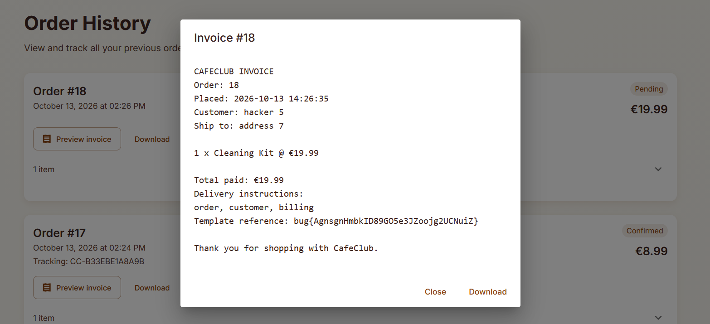

Daily challenge.
Hint: *Make sure you leave some delivery instructions.*

When ordering something in the app, there is delivery instruction field, which is later rendered into *Invoice*. The lab is vulnerable to SSTI, but classic payloads like:
- {{7\*7}}
- {{ 7*\7 }}
- {{7+7}}
- #{{7*\7}}
- ${{7*\7}}
- <% 7*\7 %>
doesn't work, they are reflected as a plain text in the invoice.
But, when I tried `{{config}}` and later check the invoice, it disappeared.
It was tricky, because classic payloads didn't worked. In the end I confirmed that the app uses *Go template*, when the `{{.}}` is injected into delivery instructions it prints the **current evaluation context** — and in this case, the context contains the flag.

