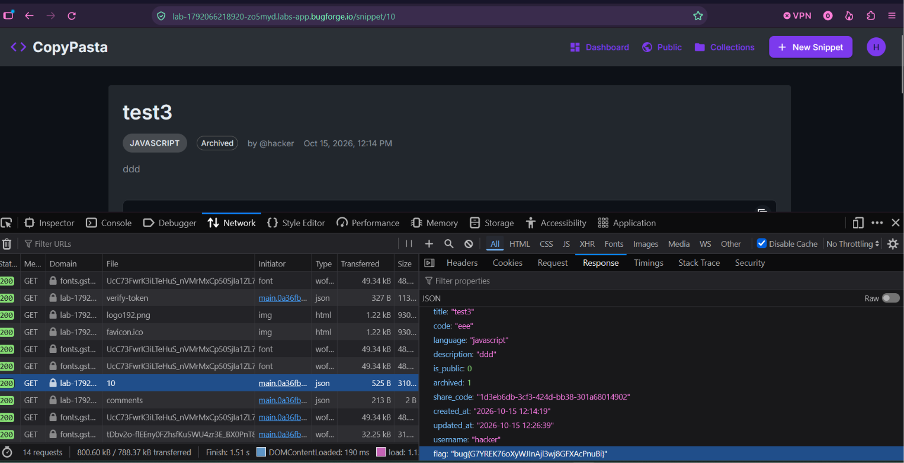

Daily challenge.
Hint: *Archive your snippet.*

In this lab there is a new feature that allows user to *archive* snippet.
I needed to create two accounts to solve this challenge.
On first account I created a non-public snippet, and viewed it in the browser with path `/snippet/10`. 
I tried to access this snippet on the second account, but since it wasn't public, I couldn't do that.
I went back to the first account and archived snippet `10`.
Now, when I tried to access snippet on the second account in the browser on path `/snippet/10`, I could do that. In the network I searched for request for 10th snippet, and in the response at the bottom I found the flag. The vulnerability here is *Broken Access Control*, the app fails to properly enforce restriction on a private snippet when it is archived.

