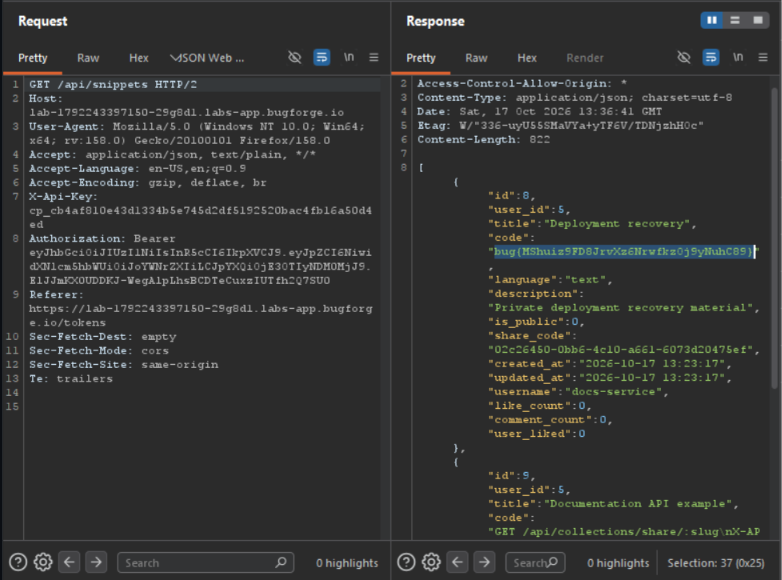

Daily challenge.
Hint: *Try changing up your JSON when generating a token.*

When creating a token, I can choose between two scopes: `full` and `public:read`.
In the JSON body of the `POST /api/tokens` request are two key-values pairs: `name` and `scope`, from the documentation I know that I can omit the `scope` and it will be set to default - `full`, but `name` key is required.
In the integration tab there is a shared key that belongs to docs-service and has public:read scope - it can read public collections, but cannot access private snippets or change content.
To grab the flag, first I created a token, and added `X-API-Key` header with shared key of *docs-service*.
Next, I changed `X-API-Key` header to my newly created token and I sent `GET` request to `/api/collections`. The response contains JSON body with information about collection of user with id *5*, who is *docs-service*.
After doing it, I sent `GET` request to `/api/snippets`, still with the token I created, and the response contains all snippets owned by `docs-service` user, including private one, which contain the flag.

It happened because in the *API Tokens* tab there is an info in the *API reference* section that states: "For automation, authenticate with `Authorization: Bearer <session token>` or `X-API-Key: <existing token>`. The authenticated account owns any token you create.". 
So, `X-API-Key` alone is enough to be authenticated and with another user token in the `X-API-Key` header, I was able to create a new token which belonged to `docs-service`, and with full scope it allowed me to read private snippets.

