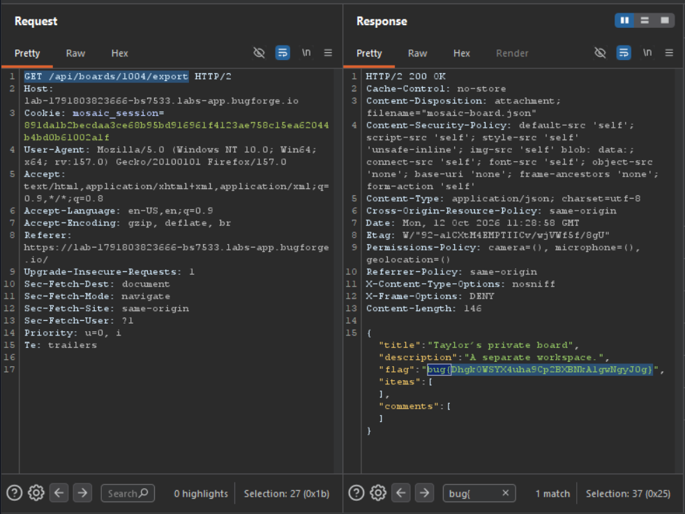

Daily challenge.
Hint: *Export you board.*

After creating an account and logging in, I created a board. At the top of the page there is a clock icon, and inside of it at the bottom is *Export board as JSON* functionality.
I found an exact request in Burp and sent it to Repeater.
The `GET /api/boards/1006/export` request has a number `1006` in it. By manipulating that number I was able to access other user board, where the flag was. 
The vulnerability in this lab is *Broken Object Level Authorization* which allows an attacker to access other users board without checking if an attacker has the permission to do so.
The request I sent was `GET /api/boards/1004/export`.

