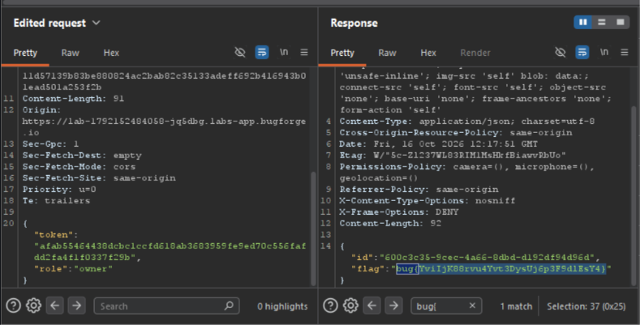

Daily challenge.
Hint: *Invite someone to your workspace.*

I registered an account and created a workspace. After enumeration I found out that a user can have three different roles in a workspace: viewer, editor or admin.
Then I invited another user by email, and opened an invitation link in the private tab. Then I created an account with an email I provided during invitation process. After registering second account on the web page I saw an invitation notification.
I opened Burp Suite and Intercepted this request `/api/invites/accept`.
Inside, there was two key-values in JSON body: token and role.
I changed a role from *viewer* to *owner*, and forwarded it.
The flag appeared in the response.

