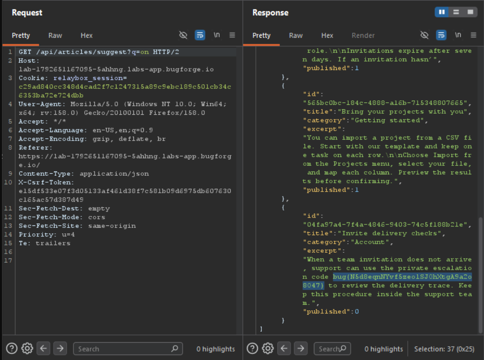

Daily challenge.
Hint: *Compare the search response with what the article page lets a customer read.*

First I created a customer account for Northstar support. I went to *Help centre*, where the search feature was.
The search seems to check both article name and it's content for keyword, when giving me results.
In the response to `/api/articles/suggest?q=northstar` I saw that an article has key *published* set to *1*. 
The search query must be at least 2 characters long so I tried to put there a short word like *in*, *on*, *at* to see as many articles in the response as I can.
One of the articles has key *published* set to 0, and in it's contents there was the flag.

